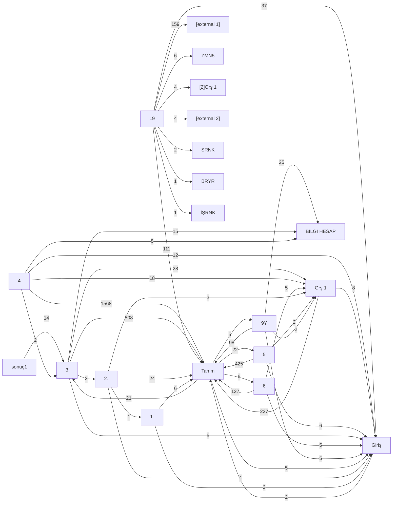

# Excel Analizi (otomatik üretilmiş bölüm)

Kaynak: `EĞİTİM 001.xlsx` ve `2.2 Gunes_Etkenligi_Model.xlsx`. Üretici: `scripts/extract/build_content.py`.

## 1. Sayfa envanteri

| # | Sayfa | Boyut | Formül | Dizi | Değer | x14 DV | DV | x14 CF | Köprü | Görsel |
|---|---|---|---|---|---|---|---|---|---|---|
| 0 | `BİLGİ HESAP` | A1:AM1289 | 0 | 0 | 2126 | 0 | 0 | 0 | 0 | 0 |
| 1 | `Tanım` | A1:FC33525 | 99914 | 0 | 307104 | 0 | 0 | 0 | 2 | 1 |
| 2 | `Giriş` | A1:Y39 | 2 | 0 | 16 | 9 | 0 | 0 | 1 | 3 |
| 3 | `Grş 1` | A1:S209 | 192 | 0 | 155 | 24 | 6 | 4 | 2 | 0 |
| 4 | `1.` | A1:AE13 | 10 | 0 | 34 | 1 | 0 | 0 | 1 | 1 |
| 5 | `2.` | A1:AV408 | 42 | 0 | 227 | 7 | 1 | 0 | 3 | 1 |
| 6 | `3` | A1:AP298 | 493 | 0 | 501 | 36 | 0 | 33 | 3 | 1 |
| 7 | `sonuç1` | A1:G13 | 1 | 4 | 36 | 0 | 0 | 0 | 0 | 0 |
| 8 | `4` | A1:AZ439 | 1516 | 0 | 1502 | 18 | 4 | 0 | 2 | 2 |
| 9 | `5` | A1:AP231 | 388 | 0 | 420 | 15 | 5 | 0 | 1 | 1 |
| 10 | `6` | A1:AL109 | 123 | 0 | 132 | 10 | 4 | 0 | 0 | 1 |
| 11 | `9Y` | A1:AM109 | 119 | 0 | 134 | 10 | 4 | 0 | 0 | 1 |
| 12 | `Sayfa5` | A1:D135 | 0 | 0 | 132 | 0 | 0 | 0 | 0 | 0 |
| 13 | `Sayfa1` | A1:D157 | 0 | 0 | 0 | 0 | 0 | 0 | 0 | 3 |
| 14 | `19` | A1:AV132 | 234 | 0 | 390 | 0 | 0 | 0 | 5 | 1 |
| 15 | `Sayfa2` | A1:N60 | 0 | 0 | 0 | 0 | 0 | 0 | 0 | 0 |
| 16 | `Sayfa3` | A1:D91 | 0 | 0 | 240 | 0 | 0 | 0 | 0 | 0 |
| 17 | `Sayfa4` | A1:G16 | 3 | 0 | 47 | 0 | 0 | 0 | 0 | 0 |

## 2. Sayfalar arası bağımlılık grafiği (formül referans sayısı)

| Kaynak sayfa | Hedef sayfa | Referans |
|---|---|---|
| `4` | `Tanım` | 1568 |
| `3` | `Tanım` | 508 |
| `5` | `Tanım` | 425 |
| `Grş 1` | `Tanım` | 227 |
| `19` | `[external 1]` | 159 |
| `6` | `Tanım` | 127 |
| `19` | `Tanım` | 111 |
| `9Y` | `Tanım` | 98 |
| `19` | `Giriş` | 37 |
| `3` | `Grş 1` | 28 |
| `9Y` | `BİLGİ HESAP` | 25 |
| `2.` | `Tanım` | 24 |
| `Tanım` | `5` | 22 |
| `Tanım` | `3` | 21 |
| `4` | `Grş 1` | 18 |
| `3` | `BİLGİ HESAP` | 15 |
| `sonuç1` | `3` | 14 |
| `4` | `Giriş` | 12 |
| `4` | `BİLGİ HESAP` | 8 |
| `Grş 1` | `Giriş` | 8 |
| `1.` | `Tanım` | 6 |
| `19` | `ZMN5` | 6 |
| `5` | `Giriş` | 6 |
| `Tanım` | `6` | 6 |
| `3` | `Giriş` | 5 |
| `6` | `Giriş` | 5 |
| `6` | `Grş 1` | 5 |
| `9Y` | `Giriş` | 5 |
| `Tanım` | `9Y` | 5 |
| `Tanım` | `Giriş` | 5 |
| `19` | `[2]Grş 1` | 4 |
| `19` | `[external 2]` | 4 |
| `2.` | `Giriş` | 4 |
| `2.` | `Grş 1` | 3 |
| `Tanım` | `Tanım` | 3 |
| `1.` | `Giriş` | 2 |
| `19` | `SRNK` | 2 |
| `3` | `2.` | 2 |
| `4` | `3` | 2 |
| `5` | `Grş 1` | 2 |
| `9Y` | `Grş 1` | 2 |
| `Giriş` | `Tanım` | 2 |
| `19` | `BRYR` | 1 |
| `19` | `İŞRNK` | 1 |
| `2.` | `1.` | 1 |

## 3. Dış bağlantılar

- `rId20` → `file:///D:\Yayla%20seres\ÇALIŞTAY\10.kitap%2010\EĞİTİM%2010%20KAÇINMA.xlsx` — sayfalar: BİLGİ HESAP, Giriş, Tanım, 1., 2., Grş 1, Sayfa1, 9Y, 9yy, YY1; önbellekli hücreler: {'Grş 1': 4}
- `rId19` → `../../../Bilirkişi/bilirkişi/Trafik%20Kazası%20Bilirkişiliği%20%20001.xlsb` — sayfalar: Tanım, Giriş, KVŞ, YOL, ARC, YLC, YAY, KRK2, NHZ3, HZD4, ZMN5, İLB6 …; önbellekli hücreler: {'Tanım': 34, 'Giriş': 20, 'ZMN5': 5, 'SRNK': 3, 'İŞRNK': 1, 'BRYR': 1}

## 4. Tanım formül yoğunluğu (ilk 10)

- `COUNTIF`: 72138
- `IFERROR`: 14596
- `VLOOKUP`: 14594
- `ROW`: 8194
- `CONCATENATE`: 4194
- `IF`: 249
- `COUNTA`: 153
- `LEFT`: 105

## 5. Etken kartları (rapor sayfalarından çıkarılan)

| Grup | Kart | Değer kaynağı | Metin düzeyi | Durum profili | Excel |
|---|---|---|---|---|---|
| yol-cevre | `yol-cevre.gun-durumu` 2.1.  GÜN DURUMU | yolCevre.gunDurumu | option | yol-cevre | 3!B9 ← Tanım!B377 |
| yol-cevre | `yol-cevre.saat-dakika` 1.4. SAAT/DAKİKA | kazaYeri.saat | factor | yol-cevre | 3!B19 ← Tanım!B386 |
| yol-cevre | `yol-cevre.hava-durumu` 2.3. HAVA DURUMU | yolCevre.havaDurumu | mixed | yol-cevre | 3!B29 ← Tanım!B393 |
| yol-cevre | `yol-cevre.yolun-sinifi` 2.4. YOLUN SINIFI | yolCevre.yolSinifi | mixed | yol-cevre | 3!B39 ← Tanım!B411 |
| yol-cevre | `yol-cevre.yolun-akis-yonu` 2.5  YOLUN AKIŞ YÖNÜ | cardSelect | factor | yol-cevre | 3!B51 ← Tanım!B430 |
| yol-cevre | `yol-cevre.yolun-kaplama-tipi` 2.6  YOLUN KAPLAMA TİPİ | cardSelect | mixed | yol-cevre | 3!B61 ← Tanım!B436 |
| yol-cevre | `yol-cevre.yolun-yuzeyi` 2.7 Yolun Yüzeyi | cardSelect | option | yol-cevre | 3!B72 ← Tanım!B444 |
| yol-cevre | `yol-cevre.kazaya-etki-eden-yol-yuzey-hatalari` 2.8  KAZAYA ETKİ EDEN YOL YÜZEY HATALARI | cardSelect | option | yol-cevre | 3!B82 ← Tanım!B456 |
| yol-cevre | `yol-cevre.kazanin-meydana-geldigi-yerin-konumu` 2.9  KAZANIN MEYDANA GELDİĞİ YERİN KONUMU | cardSelect | mixed | yol-cevre | 3!B92 ← Tanım!B466 |
| yol-cevre | `yol-cevre.yolun-cevre-ozelligi` 2.10  YOLUN ÇEVRE ÖZELLİĞİ | cardSelect | option | yol-cevre | 3!B102 ← Tanım!B478 |
| yol-cevre | `yol-cevre.serit-cizgisi` 2.11.1 Şerit Çizgisi | cardSelect | factor | yol-cevre | 3!B116 ← Tanım!B493 |
| yol-cevre | `yol-cevre.yol-elemanlari` 2.13  yol elemanları | cardSelect | option | yol-cevre | 3!B133 ← Tanım!B521 |
| yol-cevre | `yol-cevre.kaza-yeri-yatay-dikey-egimi` 2.14  KAZA YERİ YATAY DİKEY EĞİMİ | cardSelect | factor | yol-cevre | 3!B143 ← Tanım!B563 |
| yol-cevre | `yol-cevre.kaza-yeri-isaretleme` 2.14.1  KAZA YERİ İŞARETLEME | cardSelect | factor | yol-cevre | 3!B153 ← Tanım!B570 |
| yol-cevre | `yol-cevre.isikli-sesli-uyarilar` 2.15  IŞIKLI SESLİ UYARILAR | cardSelect | factor | yol-cevre | 3!B164 ← Tanım!B583 |
| yol-cevre | `yol-cevre.kor-nokta-ve-gorus-engelleri` 2.16  KÖR NOKTA VE GÖRÜŞ ENGELLERİ | cardSelect | factor | yol-cevre | 3!B175 ← Tanım!B595 |
| yol-cevre | `yol-cevre.yolda-calisma` 2.17  YOLDA ÇALIŞMA | cardSelect | factor | yol-cevre | 3!B185 ← Tanım!B606 |
| yol-cevre | `yol-cevre.yolda-calisma-isaretleme-durumu` 2.18.  YOLDA ÇALIŞMA İŞARETLEME DURUMU | cardSelect | factor | yol-cevre | 3!B195 ← Tanım!B615 |
| yol-cevre | `yol-cevre.gecit-ozellikleri` 2.19  GEÇİT ÖZELLİKLERİ | cardSelect | factor | yol-cevre | 3!B205 ← Tanım!B627 |
| yol-cevre | `yol-cevre.aydinlatma-durumu` 2.20  AYDINLATMA DURUMU | cardSelect | factor | yol-cevre | 3!B215 ← Tanım!B637 |
| yol-cevre | `yol-cevre.cevre-ve-diger-ozellikler` 2.21  ÇEVRE VE DİĞER ÖZELLİKLER | cardSelect | factor | yol-cevre | 3!B225 ← Tanım!B650 |
| yol-cevre | `yol-cevre.yolun-ozelligi` 2.22  YOLUN ÖZELLİĞİ | cardSelect | factor | yol-cevre | 3!B235 ← Tanım!B664 |
| yol-cevre | `yol-cevre.viraj` 2.22.2 Viraj | cardSelect | factor | yol-cevre | 3!B244 ← Tanım!B673 |
| yol-cevre | `yol-cevre.duz-yol` 2.22.3. Düz Yol | cardSelect | factor | yol-cevre | 3!B253 ← Tanım!B675 |
| yol-cevre | `yol-cevre.isikli-kontrol` 2.22.4  Işıklı Kontrol | cardSelect | factor | yol-cevre | 3!B263 ← Tanım!B677 |
| yol-cevre | `yol-cevre.egimli-yol` 2.22.5  Eğimli Yol | cardSelect | factor | yol-cevre | 3!B272 ← Tanım!B679 |
| yol-cevre | `yol-cevre.yaya-gecidi` 2.22.5  Yaya Geçidi | cardSelect | factor | yol-cevre | 3!B281 ← Tanım!B681 |
| yol-cevre | `yol-cevre.diger` Diğer: ........................................ | cardSelect | factor | yol-cevre | 3!B290 ← Tanım!B683 |
| yol-cevre | `yol-cevre.yolun-serit-sayisi` 2.11  YOLUN ŞERİT SAYISI | cardSelect | factor | yol-cevre | (taslak) ← Tanım!B491 |
| yol-cevre | `yol-cevre.yolun-platformu` 2.12  YOLUN PLATFORMU | cardSelect | factor | yol-cevre | (taslak) ← Tanım!B516 |
| yol-cevre | `yol-cevre.yolun-yapi-ozelligi` 2.22  YOLUN YAPI ÖZELLİĞİ | cardSelect | factor | yol-cevre | (taslak) ← Tanım!B672 |
| arac | `arac.arac-cinsi` 4.2. Araç Cinsi | araclar[0].cinsi | factor | arac | 4!B11 ← Tanım!B954 |
| arac | `arac.modeli-motor-gucu` 4.3.  Modeli - motor gücü | araclar[0].motorGucu | factor | arac | 4!B21 ← Tanım!B960 |
| arac | `arac.markasi-rengi-tipi-kg` 4.4.1. Markası / Rengi/ Tipi/kg | araclar[0].ilkDarbeBolumu | factor | arac | 4!B31 ← Tanım!B967 |
| arac | `arac.kullanim-amaci` 4.5.  Kullanım Amacı | cardSelect | factor | arac | 4!B41 ← Tanım!B979 |
| arac | `arac.aracin-fenni-muayenesi` 4.6. Aracın Fenni Muayenesi | cardSelect | factor | arac | 4!B51 ← Tanım!B992 |
| arac | `arac.tasit-sahibi` 4.7.  Taşıt sahibi | cardSelect | factor | arac | 4!B61 ← Tanım!B999 |
| arac | `arac.arac-emniyet-kemeri` 4.8. Araç Emniyet Kemeri | cardSelect | factor | arac | 4!B71 ← Tanım!B1006 |
| arac | `arac.yolcu-adedi` 4.9. Yolcu adedi | cardSelect | factor | arac | 4!B81 ← Tanım!B1012 |
| arac | `arac.araca-ait-ozel-koruyucu-tertibatlar` 4.10. Araca Ait Özel Koruyucu Tertibatlar | cardSelect | factor | arac | 4!B91 ← Tanım!B1019 |
| arac | `arac.aracin-istihap-haddi` 4.11. Aracın İstihap haddi | cardSelect | factor | arac | 4!B101 ← Tanım!B1026 |
| arac | `arac.gabari-asilmismi-veya-yukleme-durumu` 4.12. Gabari aşılmışmı veya yükleme durumu | cardSelect | factor | arac | 4!B111 ← Tanım!B1034 |
| arac | `arac.mali-sigorta-adi-police-no-tarihi` 4.13.1. Mali  Sigorta Adı-Poliçe No - Tarihi | cardSelect | factor | arac | 4!B121 ← Tanım!B1041 |
| arac | `arac.kasko-sigorta` 4.13.2. Kasko Sigorta | cardSelect | factor | arac | 4!B131 ← Tanım!B1048 |
| arac | `arac.ihtiyari-mali-sigorta` 4.13.3. İhtiyari - Mali Sigorta | cardSelect | factor | arac | 4!B141 ← Tanım!B1055 |
| arac | `arac.zorunlu-koltuk-ferdi-kaza-sigortasi` 4.13.4. Zorunlu Koltuk Ferdi Kaza Sigortası | cardSelect | factor | arac | 4!B151 ← Tanım!B1062 |
| arac | `arac.arac-yol-yetki-belgesi` 4.14. Araç Yol Yetki Belgesi | cardSelect | factor | arac | 4!B161 ← Tanım!B1069 |
| arac | `arac.yukun-degeri` 4.15.1. Yükün Değeri | cardSelect | factor | arac | 4!B171 ← Tanım!B1076 |
| arac | `arac.yukun-cinsi` 4.15.2. Yükün cinsi | cardSelect | mixed | arac | 4!B181 ← Tanım!B1084 |
| arac | `arac.yukun-son-hali` 4.15.3. Yükün son hali | cardSelect | factor | arac | 4!B191 ← Tanım!B1097 |
| arac | `arac.arac-avadanliklari-mevcutmu` 4.16. Araç avadanlıkları mevcutmu | cardSelect | factor | arac | 4!B201 ← Tanım!B1104 |
| arac | `arac.arac-yetki-belgesi` 4.17. Araç Yetki belgesi | cardSelect | factor | arac | 4!B211 ← Tanım!B1111 |
| arac | `arac.aracin-son-bakim-tarihi-ozel-araclarda-muyene-aranacak-resmi-sirket-veya-ozel-kurum-kuruluslarda-son-bakim-tarihi-aranacak` 4.18.. Aracın son bakım tarihi - (Özel araçlarda Muyene aranacak Resmi-Şirket veya özel kurum kuruluşlarda son bakım tarihi aranacak ) | cardSelect | factor | arac | 4!B221 ← Tanım!B1127 |
| arac | `arac.servis-aracinda-rehber-varmi` 4.19. Servis aracında Rehber varmı | cardSelect | factor | arac | 4!B231 ← Tanım!B1134 |
| arac | `arac.eskortluk-hizmeti` 4.20. Eskortluk hizmeti | cardSelect | factor | arac | 4!B241 ← Tanım!B1141 |
| arac | `arac.arac-ici-kamera` 4.21. Araç İçi Kamera | cardSelect | factor | arac | 4!B251 ← Tanım!B1148 |
| arac | `arac.arac-far-ve-sis-lambalari` 4.22.1. Araç Far ve sis lambaları | cardSelect | factor | arac | 4!B261 ← Tanım!B1155 |
| arac | `arac.arac-dur-sinyalleri` 4.22.2.   Araç Dur-Sinyalleri | cardSelect | factor | arac | 4!B271 ← Tanım!B1162 |
| arac | `arac.arac-sinyal-lambalari` 4.22.3.  Araç Sinyal lambaları | cardSelect | factor | arac | 4!B281 ← Tanım!B1169 |
| arac | `arac.arac-cam-filmleri` 4.23. Araç Cam filmleri | cardSelect | factor | arac | 4!B291 ← Tanım!B1176 |
| arac | `arac.amortisor-makas-arizalari` 4.24.1.Amortisör, makas, arızaları | cardSelect | factor | arac | 4!B301 ← Tanım!B1183 |
| arac | `arac.direksiyon-rot-ve-rotil-arizalari` 4.24.2.Direksiyon, rot ve rotil arızaları | cardSelect | factor | arac | 4!B311 ← Tanım!B1190 |
| arac | `arac.frenler` 4.25. Frenler, | cardSelect | factor | arac | 4!B321 ← Tanım!B1197 |
| arac | `arac.motor-ve-diferansiyel-arizalari` 4.26.1. Motor ve diferansiyel arızaları, | cardSelect | factor | arac | 4!B331 ← Tanım!B1204 |
| arac | `arac.sanzuman-hidrolik-saft-arizalari` 4.26.2. Şanzuman, hidrolik, şaft arızaları, | cardSelect | factor | arac | 4!B341 ← Tanım!B1211 |
| arac | `arac.elektrik-donanimina-bagli-arizalar` 4.27. Elektrik donanımına bağlı arızalar. | cardSelect | factor | arac | 4!B351 ← Tanım!B1218 |
| arac | `arac.arac-hiz-metre-gostergesi` 4.28. Araç hız metre göstergesi | cardSelect | factor | arac | 4!B361 ← Tanım!B1225 |
| arac | `arac.arac-hiz-vites-konumu` 4.29. Araç hız vites konumu | cardSelect | factor | arac | 4!B371 ← Tanım!B1232 |
| arac | `arac.takograf-kontrolu` 4.30. Takograf kontrolü | cardSelect | factor | arac | 4!B381 ← Tanım!B1240 |
| arac | `arac.arac-aynalari` 4.31. Araç Aynaları | cardSelect | factor | arac | 4!B391 ← Tanım!B1247 |
| arac | `arac.arac-cam-silecekleri` 4.32.  Araç Cam silecekleri | cardSelect | factor | arac | 4!B401 ← Tanım!B1254 |
| arac | `arac.digerleri` 4.33. Diğerleri | cardSelect | factor | arac | 4!B411 ← Tanım!B1261 |
| arac | `arac.d-r-plakasi-plakasi-modeli` 4.35.1. D-R Plakası Plakası Modeli | cardSelect | factor | arac | 4!B421 ← Tanım!B1281 |
| arac | `arac.kapali-kasa-dorse-dry-van-box-trailer` 2. Kapalı Kasa Dorse (Dry Van/Box Trailer) | cardSelect | mixed | arac | 4!B431 ← Tanım!B1290 |
| arac | `arac.arac-plaka` 4.1. Araç Plaka | cardSelect | factor | arac | (taslak) ← Tanım!B952 |
| arac | `arac.on-kaput-yuksekligi` 4.4.2. Ön Kaput Yüksekliği | cardSelect | factor | arac | (taslak) ← Tanım!B974 |
| arac | `arac.istem` 4.4.8. İstem | cardSelect | factor | arac | (taslak) ← Tanım!B976 |
| arac | `arac.carpismadan-sonra-aracin-hasar-durumu` 4.34.1.  Çarpışmadan sonra aracın hasar durumu | cardSelect | factor | arac | (taslak) ← Tanım!B1268 |
| arac | `arac.carpismadan-sonra-aracin-durumu` 4.34.2. Çarpışmadan sonra aracın durumu | cardSelect | factor | arac | (taslak) ← Tanım!B1273 |
| arac | `arac.aracin-carpma-sonu-durum` 4.34.3.  Aracın ÇARPMA SONU DURUM | cardSelect | factor | arac | (taslak) ← Tanım!B1276 |
| arac | `arac.ozel-tespitler` 4.36. Özel Tespitler. .......................................................................................................................................................................................................................................................................................... | cardSelect | factor | arac | (taslak) ← Tanım!B1356 |
| surucu | `surucu.surucunun-cinsiyeti-yasi` 5.1.SÜRÜCÜNÜN CİNSİYETİ - YAŞI | cardSelect | factor | kisi | 5!B14 ← Tanım!B685 |
| surucu | `surucu.boyu-kilosu-ten-rengi` 5.2.BOYU-KİLOSU-TEN RENGİ | cardSelect | factor | kisi | 5!B24 ← Tanım!B691 |
| surucu | `surucu.surucunun-son-saglik-tarihi` 5.3.SÜRÜCÜNÜN SON SAĞLIK TARİHİ | cardSelect | factor | kisi | 5!B34 ← Tanım!B698 |
| surucu | `surucu.egitimi-calistigi-kurumu-veya-kurulusu-meslegi-gorevi` 5.4.EĞİTİMİ, ÇALIŞTIĞI KURUMU VEYA KURULUŞU, MESLEĞİ, GÖREVİ | cardSelect | factor | kisi | 5!B44 ← Tanım!B705 |
| surucu | `surucu.surucu-reaksiyon-suresi` SÜRÜCÜ REAKSİYON SÜRESİ | cardSelect | factor | kisi | 5!B54 ← Tanım!B731 |
| surucu | `surucu.psikoteknik` PSİKOTEKNİK | cardSelect | factor | kisi | 5!B64 ← Tanım!B742 |
| surucu | `surucu.ticari-resmi-arac-kullanma-ehliyeti` TİCARİ-RESMİ ARAÇ KULLANMA EHLİYETİ | cardSelect | factor | kisi | 5!B74 ← Tanım!B749 |
| surucu | `surucu.surucu-ozel-izinli` SÜRÜCÜ ÖZEL İZİNLİ | cardSelect | factor | kisi | 5!B83 ← Tanım!B785 |
| surucu | `surucu.surucu-kisisel-koruyucu-ekipmanlari` SÜRÜCÜ KİŞİSEL KORUYUCU EKİPMANLARI | cardSelect | factor | kisi | 5!B93 ← Tanım!B792 |
| surucu | `surucu.surucu-guzergah-formu` SÜRÜCÜ GÜZERGAH FORMU. | cardSelect | factor | kisi | 5!B103 ← Tanım!B799 |
| surucu | `surucu.emniyet-kemeri` EMNİYET KEMERİ | cardSelect | factor | kisi | 5!B113 ← Tanım!B806 |
| surucu | `surucu.surucunun-alkol-kontrolu` SÜRÜCÜNÜN ALKOL KONTROLÜ | cardSelect | factor | kisi | 5!B123 ← Tanım!B815 |
| surucu | `surucu.surucunun-beklenmedik-davranislari` SÜRÜCÜNÜN BEKLENMEDİK DAVRANIŞLARI | cardSelect | factor | kisi | 5!B133 ← Tanım!B822 |
| surucu | `surucu.surucunun-son-sefer-gorev-gunu` SÜRÜCÜNÜN SON SEFER GÖREV GÜNÜ | cardSelect | factor | kisi | 5!B143 ← Tanım!B830 |
| surucu | `surucu.surucu-kaza-sonrasi-onlemi` SÜRÜCÜ KAZA SONRASI ÖNLEMİ | cardSelect | factor | kisi | 5!B153 ← Tanım!B842 |
| surucu | `surucu.src-tasidigi-yolcu-yuk-hakkinda-egitimi-mevcutmu` SRC TAŞIDIĞI YOLCU-YÜK HAKKINDA EĞİTİMİ MEVCUTMU | cardSelect | factor | kisi | 5!B163 ← Tanım!B849 |
| surucu | `surucu.carpmadan-sonra-surucu-durumu` ÇARPMADAN SONRA SÜRÜCÜ DURUMU | cardSelect | factor | kisi | 5!B173 ← Tanım!B858 |
| surucu | `surucu.carpmadan-sonra-surucu-hastane-deyse-elbisesi-pantolon-rengi-kriminal-112-dr-beyani` ÇARPMADAN SONRA SÜRÜCÜ HASTANE DEYSE ELBİSESİ-PANTOLON RENGİ- KRİMİNAL- 112 DR BEYANI | cardSelect | factor | kisi | 5!B183 ← Tanım!B867 |
| surucu | `surucu.suruculerin-araclara-gore-gorus-mesafesi` 4.20.  SÜRÜCÜLERİN ARAÇLARA GÖRE GÖRÜŞ MESAFESİ | cardSelect | factor | kisi | 5!B193 ← Tanım!B877 |
| surucu | `surucu.surucunun-surucu-belgesi-herhangi-bir-suctan-geri-alinma-islemi-varmi` SÜRÜCÜNÜN SÜRÜCÜ BELGESİ HERHANGİ BİR SUÇTAN GERİ ALINMA İŞLEMİ VARMI | cardSelect | factor | kisi | 5!B203 ← Tanım!B886 |
| surucu | `surucu.surucunun-daha-once-kazasi-varmi` SÜRÜCÜNÜN DAHA ÖNCE KAZASI VARMI | cardSelect | factor | kisi | 5!B213 ← Tanım!B896 |
| surucu | `surucu.sucta-tekerrur-ve-ozel-tehlikeli-sucu-varmi` SUÇTA TEKERRÜR VE ÖZEL TEHLİKELİ SUÇU VARMI? | cardSelect | factor | kisi | 5!B223 ← Tanım!B906 |
| yolcu | `yolcu.yolcunun-yasi` 8.4.  Yolcunun Yaşı | cardSelect | factor | kisi | 6!B13 ← Tanım!B1515 |
| yolcu | `yolcu.yolcunun-bulundugu-arac` 8.5. Yolcunun bulunduğu araç | cardSelect | factor | kisi | 6!B23 ← Tanım!B1520 |
| yolcu | `yolcu.yolcunun-emniyet-kemeri` 8.7.  Yolcunun Emniyet Kemeri | cardSelect | factor | kisi | 6!B33 ← Tanım!B1527 |
| yolcu | `yolcu.yolcununalkol-ilac-veya-uyusturucu-etkisi-altinda-kas-kontrolundeki-bozukluk` 8.8. YolcununAlkol, ilaç veya uyuşturucu etkisi altında kas kontrolündeki bozukluk | cardSelect | factor | kisi | 6!B43 ← Tanım!B1534 |
| yolcu | `yolcu.carpmadan-sonra-yolcularin-durumu` 8.9. Çarpmadan Sonra Yolcuların durumu | cardSelect | factor | kisi | 6!B53 ← Tanım!B1541 |
| yolcu | `yolcu.yolcu-oturma-pozisyonu-ve-sirt-dayama-durumu-durumu` 8.10. Yolcu Oturma pozisyonu ve sırt dayama durumu Durumu | cardSelect | factor | kisi | 6!B63 ← Tanım!B1545 |
| yolcu | `yolcu.a-maddesi` 8.a. Maddesi | cardSelect | factor | kisi | (taslak) ← Tanım!B1511 |
| yolcu | `yolcu.adi-soyadi` 8.1. Adı Soyadı | cardSelect | factor | kisi | (taslak) ← Tanım!B1512 |
| yolcu | `yolcu.t-c-nosu` 8.2  T.C. Nosu | cardSelect | factor | kisi | (taslak) ← Tanım!B1513 |
| yolcu | `yolcu.baba-adi` 8.3. Baba Adı | cardSelect | factor | kisi | (taslak) ← Tanım!B1514 |
| yolcu | `yolcu.yolcuda-inis-binis-anindaki-hareketler-oturma-esnasinda-yer-degistirme` 8.11 Yolcuda İniş-biniş anındaki hareketler (oturma esnasında yer değiştirme) | cardSelect | factor | kisi | (taslak) ← Tanım!B1550 |
| yolcu | `yolcu.yolcuda-inis-binis-anindaki-hareketler-oturma-esnasinda-yer-degistirme-2` 8.12 Yolcuda İniş-biniş anındaki hareketler (oturma esnasında yer değiştirme) | cardSelect | factor | kisi | (taslak) ← Tanım!B1555 |
| yolcu | `yolcu.ayakta-durma-veya-kalkmaya-calisma-hareketleri` 8.13.  Ayakta durma veya kalkmaya çalışma hareketleri | cardSelect | factor | kisi | (taslak) ← Tanım!B1561 |
| yolcu | `yolcu.yolcunun-aractan-inme-binme-kurallarina-uymamasi` 8.14.  Yolcunun araçtan inme binme kurallarına uymaması | cardSelect | factor | kisi | (taslak) ← Tanım!B1566 |
| yolcu | `yolcu.elinde-veya-kucaginda-tuttugu-esyanin-hareket-ettirici-etkisi` 8.15.  Elinde veya kucağında tuttuğu eşyanın hareket ettirici etkisi | cardSelect | factor | kisi | (taslak) ← Tanım!B1571 |
| yaya | `yaya.dogum-tarihi-yasi` 9.4. Doğum Tarihi - Yaşı | cardSelect | factor | kisi | 9Y!B13 ← Tanım!B1582 |
| yaya | `yaya.yayanin-boyu` 9.5. Yayanın Boyu | cardSelect | factor | kisi | 9Y!B23 ← Tanım!B1592 |
| yaya | `yaya.yayanin-kilosu` 9.6. Yayanın Kilosu | cardSelect | factor | kisi | 9Y!B33 ← BİLGİ HESAP!B1140 |
| yaya | `yaya.yayanin-giysi-rengi` 9.7. Yayanın giysi Rengi | cardSelect | factor | kisi | 9Y!B43 ← BİLGİ HESAP!B1148 |
| yaya | `yaya.yayanin-carpilma-noktasi` 9.8. Yayanın Çarpılma noktası | cardSelect | factor | kisi | 9Y!B53 ← Tanım!B1617 |
| yaya | `yaya.yayanin-alkol-durumu` 9.9. Yayanın Alkol Durumu | cardSelect | factor | kisi | 9Y!B63 ← BİLGİ HESAP!B1165 |
| yaya | `yaya.t-c-nosu` 9.1. T.C. Nosu | cardSelect | factor | kisi | (taslak) ← Tanım!B1578 |
| yaya | `yaya.adi-soyadi` 9.2. Adı Soyadı | cardSelect | factor | kisi | (taslak) ← Tanım!B1579 |
| yaya | `yaya.baba-adi` 9.3. Baba Adı | cardSelect | factor | kisi | (taslak) ← Tanım!B1580 |
| yaya | `yaya.cinsiyeti` 9.3.1. CİNSİYETİ | cardSelect | factor | kisi | (taslak) ← Tanım!B1581 |
| yaya | `yaya.yayanin-saglik-durumu` 9.9.2. Yayanın Sağlık Durumu | cardSelect | factor | kisi | (taslak) ← Tanım!B1635 |
| yaya | `yaya.carpmadan-sonra-yayalarin-durumu` 9.10. Çarpmadan Sonra Yayaların durumu | cardSelect | factor | kisi | (taslak) ← Tanım!B1645 |
| yaya | `yaya.yayanin-kazadaki-izleri` 9.11. Yayanın Kazadaki izleri | cardSelect | factor | kisi | (taslak) ← Tanım!B1646 |
| yaya | `yaya.yaya-tespitleri` 9.12. Yaya  Tespitleri | cardSelect | factor | kisi | (taslak) ← Tanım!B1655 |
| yaya | `yaya.yaya-ihlalleri` 9.12. Yaya İhlalleri | cardSelect | factor | kisi | (taslak) ← Tanım!B1668 |
| yaya | `yaya.kaza-oncesi-aani-ve-sonrasi-hareketi` 9.14. Kaza Öncesi, Aanı ve sonrası Hareketi | cardSelect | factor | kisi | (taslak) ← Tanım!B1676 |
| yaya | `yaya.yayanin-sorumlulugunu-kuran-illiyet` 9.15.  Yayanın sorumluluğunu kuran illiyet, | cardSelect | factor | kisi | (taslak) ← Tanım!B1694 |
| yaya | `yaya.yayanin-sorumlulugunu-sinirlayan-illiyet` 9.16.  Yayanın sorumluluğunu sınırlayan illiyet | cardSelect | factor | kisi | (taslak) ← Tanım!B1695 |
| yaya | `yaya.yayanin-kazadan-kacma-orani` 9.17. Yayanın Kazadan Kaçma % Oranı | cardSelect | factor | kisi | (taslak) ← Tanım!B1696 |
| yaya | `yaya.yaya-etkileyen-etken` 9.18. Yaya etkileyen etken | cardSelect | factor | kisi | (taslak) ← Tanım!B1697 |
| yaya | `yaya.yayanin-olasi-illiyet-bagi-baslangici` 9.19. Yayanın olası illiyet bağı başlangıcı | cardSelect | factor | kisi | (taslak) ← Tanım!B1698 |
| yaya | `yaya.yayanin-illiyet-bagi-baslangici` 9.20. Yayanın illiyet bağı başlangıcı | cardSelect | factor | kisi | (taslak) ← Tanım!B1699 |
| dorse | `dorse.markasi` 4.35.3. Markası | cardSelect | factor | arac | (taslak) ← Tanım!B1284 |
| dorse | `dorse.dorse-kullanim-amaci` 4.35.4.  Dorse Kullanım Amacı | cardSelect | factor | arac | (taslak) ← Tanım!B1286 |
| dorse | `dorse.dorse-tasit-sahibi` 4.35.5.   Dorse Taşıt sahibi | cardSelect | factor | arac | (taslak) ← Tanım!B1299 |
| dorse | `dorse.dorse-fenni-muayenesi` 4.35.6. Dorse Fenni Muayenesi | cardSelect | factor | arac | (taslak) ← Tanım!B1302 |
| dorse | `dorse.muhurlu-dorselerde-havarie-komserligi-bilgi-verilmesi` 4.35.7. Mühürlü dorselerde Havarie Komserliği bilgi verilmesi | cardSelect | factor | arac | (taslak) ← Tanım!B1307 |
| dorse | `dorse.dorse-arac-hasar-degeri` 4.35.8. Dorse Araç Hasar Değeri | cardSelect | factor | arac | (taslak) ← Tanım!B1314 |
| dorse | `dorse.tasiyici-sirkete-bilgi-verildimi-firma-eksik-tespit-maddesi-ozel-kamu-kuruluslarda-tespit-edilen-eksiklikler-islenecektir` 4.35.9. Taşıyıcı şirkete bilgi verildimi Firma eksik Tespit Maddesi ( Özel-Kamu kuruluşlarda tespit edilen eksiklikler işlenecektir) | cardSelect | factor | arac | (taslak) ← Tanım!B1321 |
| dorse | `dorse.dorse-elektrik-donanimina-bagli-arizalar` 4.35.10. dorse Elektrik donanımına bağlı arızalar. | cardSelect | factor | arac | (taslak) ← Tanım!B1328 |
| dorse | `dorse.dorse-amortisorler-makaslar-takim-arizalari` 4.35.11. Dorse Amortisörler, makaslar, takım arızaları | cardSelect | factor | arac | (taslak) ← Tanım!B1335 |
| dorse | `dorse.dorse-frenler` 4.35.12. Dorse Frenler, | cardSelect | factor | arac | (taslak) ← Tanım!B1342 |
| dorse | `dorse.dorse-king-pimi-arazasi` 4.35.13. Dorse king pimi arazası, | cardSelect | factor | arac | (taslak) ← Tanım!B1349 |
| iz | `iz.dokuntu-izleri` 6.1.. Döküntü izleri | cardSelect | factor | kisi | (taslak) ← Tanım!B1365 |
| iz | `iz.enkaz-izleri` 6.2.. Enkaz izleri | cardSelect | factor | kisi | (taslak) ← Tanım!B1371 |
| iz | `iz.yuk-izleri` 6.3. Yük izleri | cardSelect | factor | kisi | (taslak) ← Tanım!B1378 |
| iz | `iz.diger-izler` 6.4. Diğer izler | cardSelect | factor | kisi | (taslak) ← Tanım!B1385 |
| iz | `iz.kazaya-etken-arac-ve-baska-yuk-izleri` 6.5. Kazaya Etken araç ve başka yük izleri ................................................................................................................................................................. | cardSelect | factor | kisi | (taslak) ← Tanım!B1392 |
| iz | `iz.lastik-mevsimlik-durumu` 7.1.  Lastik Mevsimlik durumu | cardSelect | factor | kisi | (taslak) ← Tanım!B1404 |
| iz | `iz.arac-lastik-izleri` 7.2. Araç Lastik  İzleri | cardSelect | factor | kisi | (taslak) ← Tanım!B1411 |
| iz | `iz.lastik-imal` 7.3.1.  Lastik İmal | cardSelect | factor | kisi | (taslak) ← Tanım!B1421 |
| iz | `iz.lastik-imal-2` 7.3.1.  Lastik İmal | cardSelect | factor | kisi | (taslak) ← Tanım!B1432 |
| iz | `iz.lastik-dis-derinlikleri` 7.4.  Lastik Diş Derinlikleri | cardSelect | factor | kisi | (taslak) ← Tanım!B1439 |
| iz | `iz.cizme-cizilme-izleri` 7.5. Çizme- Çizilme İzleri | cardSelect | factor | kisi | (taslak) ← Tanım!B1447 |
| iz | `iz.jant-izleri` 7.6. Jant İzleri | cardSelect | factor | kisi | (taslak) ← Tanım!B1455 |
| iz | `iz.virajda-agirlik-transfer-izleri` 7.7.  Virajda Ağırlık Transfer İzleri | cardSelect | factor | kisi | (taslak) ← Tanım!B1462 |
| iz | `iz.fren-izi-ans-abs-vb-sistemler` 7.8.  Fren İzi (ANS-ABS) vb sistemler | cardSelect | factor | kisi | (taslak) ← Tanım!B1470 |
| iz | `iz.kesik-fren-izi` 7.9  Kesik Fren İzi | cardSelect | factor | kisi | (taslak) ← Tanım!B1479 |
| iz | `iz.suruklenme-kayma` 7.10.  Sürüklenme Kayma | cardSelect | factor | kisi | (taslak) ← Tanım!B1492 |
| iz | `iz.savrulma-izi` 7.11..  Savrulma İzi | cardSelect | factor | kisi | (taslak) ← Tanım!B1501 |
| olu-yarali | `olu-yarali.doku-ve-organ-izleri` 10.1. Doku ve Organ İzleri | cardSelect | factor | kisi | (taslak) ← Tanım!B1703 |
| olu-yarali | `olu-yarali.kan-veya-vucut-sivisi` 10.2. Kan veya Vucut Sıvısı | cardSelect | factor | kisi | (taslak) ← Tanım!B1709 |
| olu-yarali | `olu-yarali.suruklenme-izleri` 10.3. Sürüklenme İzleri | cardSelect | factor | kisi | (taslak) ← Tanım!B1715 |
| olu-yarali | `olu-yarali.esya-giysi-izleri-ve-bulunduklari-yerler` 10.4. Eşya Giysi izleri ve bulundukları Yerler. | cardSelect | factor | kisi | (taslak) ← Tanım!B1721 |
| kaza-nedeni | `kaza-nedeni.kazanin-siddet-duzeyi` 11.1. Kazanın şiddet düzeyi | cardSelect | factor | kisi | (taslak) ← Tanım!B1731 |
| kaza-nedeni | `kaza-nedeni.kazanin-gercek-nedeni` 11.2. Kazanın Gerçek nedeni | cardSelect | factor | kisi | (taslak) ← Tanım!B1734 |
| kaza-nedeni | `kaza-nedeni.kazanin-olasi-nedeni` 11.3. Kazanın Olası nedeni | cardSelect | factor | kisi | (taslak) ← Tanım!B1737 |
| kaza-nedeni | `kaza-nedeni.kazanin-temel-nedeni` 11.4. Kazanın Temel Nedeni | cardSelect | factor | kisi | (taslak) ← Tanım!B1740 |
| kaza-nedeni | `kaza-nedeni.kaza-icin-tedbir-alinabilirmi` 11.5. Kaza için tedbir alınabilirmi | cardSelect | factor | kisi | (taslak) ← Tanım!B1743 |
| kaza-nedeni | `kaza-nedeni.kazanin-ozelligi` 11.6. kazanın Özelliği | cardSelect | factor | kisi | (taslak) ← Tanım!B1746 |

Toplam kart: **178** (3: 31, 4: 50, 5: 22, 6: 15, 9Y: 22).
Tanım kütüphanesinde numaralı başlık: **230**; rapor sayfalarında kullanılmayan ve taslak olarak taşınan: **73**.

## 6. Durum kural profilleri (V sütunu IF zincirlerinden)

- **yol-cevre** (ilk görüldüğü yer `3!V11`, sayfalar ['3']): `{"": "", "Yeterli": "ETKEN DEĞİL", "Yetersiz": "İNCELENMELİ", "Aranmadı": "ETKEN DEĞİL", "Yok": "ETKEN", "Davranış": "İNCELENMELİ", "Var": "ETKEN DEĞİL", "Belirsiz": "İNCELENMELİ"}`, tanımsız → `FALSE`
- **arac** (ilk görüldüğü yer `4!V13`, sayfalar ['4']): `{"": "", "Yeterli": "ETKEN DEĞİL", "Yetersiz": "ÖZEL İSTEMLİ", "Aranmadı": "ETKEN DEĞİL", "Yok": "ETKEN", "Belirsiz": "İNCELEMELİ", "Var": "ETKEN DEĞİL"}`, tanımsız → `FALSE`
- **kisi** (ilk görüldüğü yer `5!V16`, sayfalar ['5', '6', '9Y']): `{"": "", "Yeterli": "ETKEN DEĞİL", "Yetersiz": "İNCELENMELİ", "Aranmadı": "ETKEN DEĞİL", "Yok": "ETKEN", "Belirsiz": "ÖZEL İSTEMLİ", "Var": "ETKEN DEĞİL"}`, tanımsız → `FALSE`

## 7. Listeler: 130 ayrı kaynak aralığı

| Liste | Kaynak | Öğe | Kullanım |
|---|---|---|---|
| `tanim-ad3-ad92` | `Tanım!AD3:AD92` | 17 | Giriş!M9:R9 |
| `tanim-g4-g85` | `Tanım!G4:G85` | 81 | Giriş!M8:R8, Grş 1!D140:G140 |
| `tanim-e86-e108` | `Tanım!E86:E108` | 3 | Giriş!M7:R7 |
| `tanim-f62-f162` | `Tanım!F62:F162` | 101 | Giriş!M11 |
| `tanim-e2-e7` | `Tanım!E2:E7` | 6 | Giriş!J4:R5 |
| `tanim-d60-d76` | `Tanım!D60:D76` | 16 | Giriş!M13:R13 |
| `tanim-b46-b61` | `Tanım!B46:B61` | 14 | Giriş!N11:R11 |
| `tanim-af3-af150` | `Tanım!AF3:AF150` | 0 | Giriş!M10:R10 |
| `tanim-e86-e113` | `Tanım!E86:E113` | 3 | Giriş!J2:R3 |
| `bilgi-hesap-b90-b97` | `BİLGİ HESAP!B90:B97` | 7 | Grş 1!E28:H28 |
| `tanim-d23-d32` | `Tanım!D23:D32` | 8 | Grş 1!D123 D114 D92:D96 D85:D88 D75:D83 D107:F107, 3!E31 E207 E94 E104 E21 E118 E155 E145 E187 E135 E166 E177 E265 E74 E84 E283 E11 E197 E53 E217 E227 E274 E237 E246 E255 E292 E41 E63, 4!E423 E13 E23 E33 E43 E53 E63 E73 E83 E93 E103 E113 E123 E133 E143 E153 E163 E173 E183 E193 E203 E213 E223 E233 E243 E253 E263 E273 E283 E293 E303 E313 E323 E333 E343 E353 E363 E383 E393 E373 E403 E413 E433 AE423 AE13 AE23 AE33 AE43 AE53 AE63 AE73 AE83 AE93 AE103 AE113 AE123 AE133 AE143 AE153 AE163 AE173 AE183 AE193 AE203 AE213 AE223 AE233 AE243 AE253 AE263 AE273 AE283 AE293 AE303 AE313 AE323 AE333 AE343 AE353 AE363 AE383 AE393 AE373 AE403 AE413 AE433, 5!E36 E46 E56 E16 E26 E66 E76 E85 E95 E105 E115 E125 E135 E145 E155 E165 E175 E185 E195 E205 E215 E225 |
| `bilgi-hesap-b243-b250` | `BİLGİ HESAP!B243:B250` | 7 | Grş 1!E113:H113 |
| `bilgi-hesap-b253-b261` | `BİLGİ HESAP!B253:B261` | 0 | Grş 1!E122:H122 |
| `bilgi-hesap-b264-b276` | `BİLGİ HESAP!B264:B276` | 12 | Grş 1!E131:H131 |
| `tanim-g97-g103` | `Tanım!G97:G103` | 5 | Grş 1!J28 J113 J122 J131, 3!S103 S93 S83 |
| `tanim-d37-d45` | `Tanım!D37:D45` | 6 | Grş 1!E34:G34 I34 D119:G119 I119 D128:G128 I128, 3!S298 S124 S70 S17 S59 S90 S80 S100 S141 S183 S37 S203 S161 S193 S172 S151 S110 S213 S223 S233 S242 S251 S260 S270 E288 S279 S27 S47, 4!AS299 AS29 AS49 S49 AS69 S69 AS89 S89 AS99 AS109 AS119 AS129 AS139 AS149 AS159 AS169 AS179 AS189 AS199 AS209 AS219 S239 S259 AS259 AS269 S269 AS289 S289 S309 AS309 AS329 S329 AS349 S349 AS359 AS369 S389 AS399 AS409 AS379 AS419 AS429 S29 AS19 S39 AS39 S59 AS59 S79 AS79 S99 S109 S119 S129 S139 S149 S159 S169 S179 S189 S199 S209 S219 S229 AS239 S249 AS229 AS249 S279 AS279 S299 S19 S319 AS319 S339 AS339 S359 S369 S379 AS389 S409 S419 S399 S429 S439 AS439, 5!S141 S32 S121 S52 S221 S22 S111 S161 S201 S231 S151 S62 S191 S72 S42 E81 S181 S91 S171 S101 S131 S211 |
| `tanim-c271-q271` | `Tanım!C271:Q271` | 13 | Grş 1!D47 |
| `tanim-c270-l270` | `Tanım!C270:L270` | 0 | Grş 1!D49 |
| `tanim-c344-h344` | `Tanım!C344:H344` | 6 | Grş 1!D139:G139 |
| `tanim-c347-h347` | `Tanım!C347:H347` | 5 | Grş 1!D143:G143 |
| `bilgi-hesap-d513-x513` | `BİLGİ HESAP!D513:X513` | 19 | Grş 1!D104:F104 |
| `tanim-c294-r294` | `Tanım!C294:R294` | 14 | Grş 1!D89 |
| `tanim-c295-h295` | `Tanım!C295:H295` | 3 | Grş 1!D90 |
| `tanim-c296-n296` | `Tanım!C296:N296` | 11 | Grş 1!D91 |
| `tanim-b982-b991` | `Tanım!B982:B991` | 10 | Grş 1!D106:F106 |
| `tanim-b1086-b1096` | `Tanım!B1086:B1096` | 11 | Grş 1!D112:F112 |
| `bilgi-hesap-b4-b13` | `BİLGİ HESAP!B4:B13` | 5 | Grş 1!D42 |
| `tanim-b395-b408` | `Tanım!B395:B408` | 12 | Grş 1!D43 |
| `tanim-b413-b428` | `Tanım!B413:B428` | 15 | Grş 1!D44 |
| `tanim-b432-b435` | `Tanım!B432:B435` | 3 | Grş 1!D45 |
| `tanim-c83-c88` | `Tanım!C83:C88` | 5 | Grş 1!D21 |
| `tanim-c90-c96` | `Tanım!C90:C96` | 6 | Grş 1!D22 |
| `grs-1-i136-l136` | `Grş 1!I136:L136` | 0 | Grş 1!D137:G137 D158:F158 |
| `grs-1-i137-m137` | `Grş 1!I137:M137` | 3 | Grş 1!D138:G138 D159:F159 |
| `grs-1-i141-m141` | `Grş 1!I141:M141` | 2 | Grş 1!D142:G142 |
| `grs-1-i143-k143` | `Grş 1!I143:K143` | 0 | Grş 1!D144:G144 D163:F163 |
| `grs-1-i144-p144` | `Grş 1!I144:P144` | 4 | Grş 1!D145:F146 |
| `grs-1-b967-b976` | `Grş 1!B967:B976` | 0 | Grş 1!D108:F108 |
| `tanim-f62-f111` | `Tanım!F62:F111` | 50 | 1.!R3 T3, 2.!R3 T3, 3!R3 T3, 4!R3 T3 AR3 AT3 |
| `tanim-f62-f71` | `Tanım!F62:F71` | 10 | 2.!U15 |
| `tanim-g104-g144` | `Tanım!G104:G144` | 40 | 2.!N15 |
| `tanim-ab2-ab27` | `Tanım!AB2:AB27` | 17 | 2.!U17 X17 |
| `tanim-f61-f85` | `Tanım!F61:F85` | 24 | 2.!X15 |
| `tanim-f61-f211` | `Tanım!F61:F211` | 150 | 2.!L15 |
| `tanim-ap2-ap53` | `Tanım!AP2:AP53` | 51 | 2.!J15 |
| `bilgi-hesap-b37-b43` | `BİLGİ HESAP!B37:B43` | 6 | 3!E62 |
| `bilgi-hesap-b32-b36` | `BİLGİ HESAP!B32:B36` | 4 | 3!V39 |
| `tanim-f62-f99` | `Tanım!F62:F99` | 38 | 3!Y127:Y129 |
| `tanim-b446-b454` | `Tanım!B446:B454` | 8 | 3!E73:G73 |
| `tanim-e61-e80` | `Tanım!E61:E80` | 19 | 3!J144 H144 |
| `bilgi-hesap-b189-b199` | `BİLGİ HESAP!B189:B199` | 9 | 3!E176 |
| `bilgi-hesap-b151-b158` | `BİLGİ HESAP!B151:B158` | 7 | 3!E165 |
| `bilgi-hesap-b207-b215` | `BİLGİ HESAP!B207:B215` | 9 | 3!E206 |
| `tanim-b565-b569` | `Tanım!B565:B569` | 4 | 3!E154:K154 |
| `bilgi-hesap-b233-b241` | `BİLGİ HESAP!B233:B241` | 8 | 3!E196 |
| `bilgi-hesap-b223-b230` | `BİLGİ HESAP!B223:B230` | 7 | 3!E186 |
| `bilgi-hesap-b48-b56` | `BİLGİ HESAP!B48:B56` | 9 | 3!E93 |
| `tanim-e40-e60` | `Tanım!E40:E60` | 21 | 3!E90:O90 E100:O100 E298:O298 E124:O124 E80:O80 E47:O47 E37:O37 E17:O17 E59:O59 E70:O70 E110:O110 E151:O151 E161:O161 E172:O172 E183:O183 E193:O193 E203:O203 E213:O213 E223:O223 E233:O233 E242:O242 E251:O251 E260:O260 E270:O270 P288:Z288 E279:O279 E27:O27 E141:O141, 4!E29:O29 E39:O39 E49:O49 E59:O59 E69:O69 E79:O79 E89:O89 E99:O99 E109:O109 E119:O119 E129:O129 E139:O139 E149:O149 E159:O159 E169:O169 E179:O179 E189:O189 E199:O199 E209:O209 E219:O219 E229:O229 E239:O239 E249:O249 E259:O259 E269:O269 E279:O279 E289:O289 E299:O299 AE309:AO309 E319:O319 E329:O329 E339:O339 E349:O349 E359:O359 E369:O369 E379:O379 E389:O389 E409:O409 E419:O419 E399:O399 E429:O429 E439:O439 E19:O19 AE29:AO29 AE39:AO39 AE49:AO49 AE59:AO59 AE69:AO69 AE79:AO79 AE89:AO89 AE99:AO99 AE109:AO109 AE119:AO119 AE129:AO129 AE139:AO139 AE149:AO149 AE159:AO159 AE169:AO169 AE179:AO179 AE189:AO189 AE199:AO199 AE209:AO209 AE219:AO219 AE229:AO229 AE239:AO239 AE249:AO249 AE259:AO259 AE269:AO269 AE279:AO279 AE289:AO289 AE299:AO299 AE19:AO19 AE319:AO319 AE329:AO329 AE339:AO339 AE349:AO349 AE359:AO359 AE369:AO369 AE379:AO379 AE389:AO389 AE409:AO409 AE419:AO419 AE399:AO399 AE429:AO429 AE439:AO439 E309:O309, 5!E131:O131 E22:O22 E32:O32 E42:O42 E52:O52 E62:O62 P81:Z81 E72:O72 E91:O91 E101:O101 E111:O111 E221:O221 E121:O121 E141:O141 E231:O231 E151:O151 E171:O171 E181:O181 E191:O191 E201:O201 E161:O161 E211:O211, 6!E31:O31 E41:O41 E51:O51 E61:O61 E71:O71 E21:O21 |
| `tanim-b458-b465` | `Tanım!B458:B465` | 7 | 3!E83:L83 |
| `tanim-b494-b501` | `Tanım!B494:B501` | 8 | 3!K117:U117 |
| `tanim-b522-b529` | `Tanım!B522:B529` | 8 | 3!E134:G134 |
| `tanim-b638-b644` | `Tanım!B638:B644` | 7 | 3!E216:L216 |
| `tanim-b652-b660` | `Tanım!B652:B660` | 9 | 3!E103 |
| `tanim-b652-b663` | `Tanım!B652:B663` | 10 | 3!E226:L226 |
| `tanim-b504-i504` | `Tanım!B504:I504` | 5 | 3!E117:G117 S144:U144 S154:U154 S165:U165 S176:U176 S186:U186 S196:U196 S206:U206 S216:U216 S226:U226 S236:U236 S245:U245 S254:U254 S264:U264 S273:U273 S282:U282 S291:U291 |
| `tanim-b388-b390` | `Tanım!B388:B390` | 3 | 3!B22:D22 |
| `tanim-aa123-aa258` | `Tanım!AA123:AA258` | 112 | 3!O159:Z159 |
| `tanim-b565-b568` | `Tanım!B565:B568` | 4 | 3!E144 |
| `tanim-b665-b671` | `Tanım!B665:B671` | 7 | 3!H236:L236 |
| `tanim-d666-m666` | `Tanım!D666:M666` | 3 | 3!H245:L245 H291:L291 H264:L264 H273:L273 H282:L282 |
| `tanim-b673-b683` | `Tanım!B673:B683` | 6 | 3!E245 E236 E273 E282 E291 E264 E254 |
| `tanim-e20-e29` | `Tanım!E20:E29` | 7 | 3!H254:L254 |
| `tanim-c96-c110` | `Tanım!C96:C110` | 8 | 3!K79 K16 E16 H16 K26 E26 H26 K46 E46 H46 K36 E36 H36 K69 E69 H69 E79 H79 K58 E58 H58 K89 E89 H89 K99 E99 H99 K109 E109 H109 K123 E123 H123 K150 E150 H150 K160 E160 H160 K171 E171 H171 K182 E182 H182 K192 E192 H192 K202 E202 H202 K212 E212 H212 K222 E222 H222 K232 E232 H232 K241 E241 H241 K250 E250 H250 K259 E259 H259 K269 E269 H269 K278 E278 H278 K297 E297 H297 K140 E140 H140, 4!K438 E438 H438 K428 E428 H428 K418 E418 H418 K408 E408 H408 K398 E398 H398 K388 E388 H388 K378 E378 H378 K368 E368 H368 K358 E358 H358 K348 E348 H348 K338 E338 H338 K328 E328 H328 K318 E318 H318 K308 E308 H308 K298 E298 H298 K288 E288 H288 K278 E278 H278 K268 E268 H268 K258 E258 H258 K248 E248 H248 K238 E238 H238 K228 E228 H228 K218 E218 H218 K208 E208 H208 K198 E198 H198 K188 E188 H188 K178 E178 H178 K168 E168 H168 K158 E158 H158 K148 E148 H148 K138 E138 H138 K128 E128 H128 K118 E118 H118 K108 E108 H108 K98 E98 H98 K88 E88 H88 K78 E78 H78 K68 E68 H68 K58 E58 H58 K48 E48 H48 K38 E38 H38 K28 E28 H28 K18 E18 H18 AK438 AE438 AH438 AK428 AE428 AH428 AK418 AE418 AH418 AK408 AE408 AH408 AK398 AE398 AH398 AK388 AE388 AH388 AK378 AE378 AH378 AK368 AE368 AH368 AK358 AE358 AH358 AK348 AE348 AH348 AK338 AE338 AH338 AK328 AE328 AH328 AK318 AE318 AH318 AK308 AE308 AH308 AK298 AE298 AH298 AK288 AE288 AH288 AK278 AE278 AH278 AK268 AE268 AH268 AK258 AE258 AH258 AK248 AE248 AH248 AK238 AE238 AH238 AK228 AE228 AH228 AK218 AE218 AH218 AK208 AE208 AH208 AK198 AE198 AH198 AK188 AE188 AH188 AK178 AE178 AH178 AK168 AE168 AH168 AK158 AE158 AH158 AK148 AE148 AH148 AK138 AE138 AH138 AK128 AE128 AH128 AK118 AE118 AH118 AK108 AE108 AH108 AK98 AE98 AH98 AK88 AE88 AH88 AK78 AE78 AH78 AK68 AE68 AH68 AK58 AE58 AH58 AK48 AE48 AH48 AK38 AE38 AH38 AK28 AE28 AH28 AK18 AE18 AH18, 5!K130 E130 H130 K21 E21 H21 K31 E31 H31 K41 E41 H41 K51 E51 H51 K61 E61 H61 K71 E71 H71 K90 E90 H90 K100 E100 H100 K110 E110 H110 K120 E120 H120 K140 E140 H140 K150 E150 H150 K170 E170 H170 K180 E180 H180 K190 E190 H190 K160 E160 H160 K220 E220 H220 K230 E230 H230 K200 E200 H200 K210 E210 H210, 6!K70 E70 H70 K60 E60 H60 K50 E50 H50 K40 E40 H40 K30 E30 H30 K20 E20 H20 |
| `tanim-b107-b111` | `Tanım!B107:B111` | 2 | 3!X79:Z79 X16:Z16 X26:Z26 X46:Z46 X36:Z36 X69:Z69 X58:Z58 X89:Z89 X99:Z99 X109:Z109 X123:Z123 X150:Z150 X160:Z160 X171:Z171 X182:Z182 X192:Z192 X202:Z202 X212:Z212 X222:Z222 X232:Z232 X241:Z241 X250:Z250 X259:Z259 X269:Z269 X278:Z278 X297:Z297 X140:Z140, 4!X438:Z438 X428:Z428 X418:Z418 X408:Z408 X398:Z398 X388:Z388 X378:Z378 X368:Z368 X358:Z358 X348:Z348 X338:Z338 X328:Z328 X318:Z318 X308:Z308 X298:Z298 X288:Z288 X278:Z278 X268:Z268 X258:Z258 X248:Z248 X238:Z238 X228:Z228 X218:Z218 X208:Z208 X198:Z198 X188:Z188 X178:Z178 X168:Z168 X158:Z158 X148:Z148 X138:Z138 X128:Z128 X118:Z118 X108:Z108 X98:Z98 X88:Z88 X78:Z78 X68:Z68 X58:Z58 X48:Z48 X38:Z38 X28:Z28 X18:Z18 AX438:AZ438 AX428:AZ428 AX418:AZ418 AX408:AZ408 AX398:AZ398 AX388:AZ388 AX378:AZ378 AX368:AZ368 AX358:AZ358 AX348:AZ348 AX338:AZ338 AX328:AZ328 AX318:AZ318 AX308:AZ308 AX298:AZ298 AX288:AZ288 AX278:AZ278 AX268:AZ268 AX258:AZ258 AX248:AZ248 AX238:AZ238 AX228:AZ228 AX218:AZ218 AX208:AZ208 AX198:AZ198 AX188:AZ188 AX178:AZ178 AX168:AZ168 AX158:AZ158 AX148:AZ148 AX138:AZ138 AX128:AZ128 AX118:AZ118 AX108:AZ108 AX98:AZ98 AX88:AZ88 AX78:AZ78 AX68:AZ68 AX58:AZ58 AX48:AZ48 AX38:AZ38 AX28:AZ28 AX18:AZ18, 5!X130:Z130 X21:Z21 X31:Z31 X41:Z41 X51:Z51 X61:Z61 X71:Z71 X90:Z90 X100:Z100 X110:Z110 X120:Z120 X140:Z140 X150:Z150 X170:Z170 X180:Z180 X190:Z190 X160:Z160 X220:Z220 X230:Z230 X200:Z200 X210:Z210, 6!X70:Z70 X60:Z60 X50:Z50 X40:Z40 X30:Z30 X20:Z20 |
| `tanim-d2000-d2080` | `Tanım!D2000:D2080` | 60 | 3!P16 Q150:T150 Q278:T278 Q259:T259 Q297:T297 Q250:T250 Q222:T222 Q269:T269 Q241:T241 Q212:T212 Q202:T202 Q26:T26 Q58:T58 Q36:T36 Q182:T182 Q171:T171 Q160:T160 Q140:T140 Q123:T123 Q109:T109 Q99:T99 Q69:T69 Q89:T89 Q79:T79 Q46:T46 Q192:T192 Q232:T232, 4!P438 AP18 AP28 AP38 AP48 AP58 AP68 AP78 AP88 AP98 AP108 AP118 AP128 AP138 AP148 AP158 AP168 AP178 AP188 AP198 AP208 AP218 AP228 AP238 AP248 AP258 AP268 AP278 AP288 AP298 AP308 AP318 AP328 AP338 AP348 AP358 AP368 AP378 AP388 AP398 AP408 AP418 AP428 AP438 P18 P28 P38 P48 P58 P68 P78 P88 P98 P108 P118 P128 P138 P148 P158 P168 P178 P188 P198 P208 P218 P228 P238 P248 P258 P268 P278 P288 P298 P308 P318 P328 P338 P348 P358 P368 P378 P388 P398 P408 P418 P428, 5!P130 P210 P200 P230 P220 P160 P190 P180 P170 P150 P140 P120 P110 P100 P90 P71 P61 P51 P41 P31 P21, 6!P70 P20 P30 P40 P50 P60 |
| `tanim-e2000-e2080` | `Tanım!E2000:E2080` | 17 | 3!Q16:T16, 4!Q438:T438 Q428:T428 Q418:T418 Q408:T408 Q398:T398 Q388:T388 Q378:T378 Q368:T368 Q358:T358 Q348:T348 Q338:T338 Q328:T328 Q318:T318 Q308:T308 Q298:T298 Q288:T288 Q278:T278 Q268:T268 Q258:T258 Q248:T248 Q238:T238 Q228:T228 Q218:T218 Q208:T208 Q198:T198 Q188:T188 Q178:T178 Q168:T168 Q158:T158 Q148:T148 Q138:T138 Q128:T128 Q118:T118 Q108:T108 Q98:T98 Q88:T88 Q78:T78 Q68:T68 Q58:T58 Q48:T48 Q38:T38 Q28:T28 Q18:T18 AQ438:AT438 AQ428:AT428 AQ418:AT418 AQ408:AT408 AQ398:AT398 AQ388:AT388 AQ378:AT378 AQ368:AT368 AQ358:AT358 AQ348:AT348 AQ338:AT338 AQ328:AT328 AQ318:AT318 AQ308:AT308 AQ298:AT298 AQ288:AT288 AQ278:AT278 AQ268:AT268 AQ258:AT258 AQ248:AT248 AQ238:AT238 AQ228:AT228 AQ218:AT218 AQ208:AT208 AQ198:AT198 AQ188:AT188 AQ178:AT178 AQ168:AT168 AQ158:AT158 AQ148:AT148 AQ138:AT138 AQ128:AT128 AQ118:AT118 AQ108:AT108 AQ98:AT98 AQ88:AT88 AQ78:AT78 AQ68:AT68 AQ58:AT58 AQ48:AT48 AQ38:AT38 AQ28:AT28 AQ18:AT18, 5!Q130:T130 Q21:T21 Q31:T31 Q41:T41 Q51:T51 Q61:T61 Q71:T71 Q90:T90 Q100:T100 Q110:T110 Q120:T120 Q140:T140 Q150:T150 Q170:T170 Q180:T180 Q190:T190 Q160:T160 Q220:T220 Q230:T230 Q200:T200 Q210:T210, 6!Q70:T70 Q60:T60 Q50:T50 Q40:T40 Q30:T30 Q20:T20 |
| `tanim-c2000-c2080` | `Tanım!C2000:C2080` | 80 | 3!P192 P182 P171 P160 P150 P140 P123 P109 P99 P89 P79 P69 P58 P46 P36 P26 P202 P212 P222 P250 P259 P278 P297 P269 P241 P232 |
| `tanim-b968-b971` | `Tanım!B968:B971` | 4 | 4!B32:D32 AB32:AD32 |
| `tanim-c311-o311` | `Tanım!C311:O311` | 7 | 4!E42:G42 AE42:AG42 |
| `tanim-g993-g998` | `Tanım!G993:G998` | 5 | 4!E52:G52 AE52:AG52 |
| `tanim-g1006-g1009` | `Tanım!G1006:G1009` | 2 | 4!E72:G72 AE72:AG72 |
| `tanim-g1013-g1016` | `Tanım!G1013:G1016` | 2 | 4!E82:G82 AE82:AG82 |
| `tanim-g1020-g1021` | `Tanım!G1020:G1021` | 0 | 4!E92:G92 AE92:AG92 |
| `tanim-g1248-g1252` | `Tanım!G1248:G1252` | 3 | 4!E402:G402 AE402:AG402 |
| `tanim-g1239-g1244` | `Tanım!G1239:G1244` | 0 | 4!E392:G392 AE392:AG392 |
| `tanim-b1289-b1298` | `Tanım!B1289:B1298` | 9 | 4!E432:G432 AE432:AG432 |
| `tanim-b1087-b1096` | `Tanım!B1087:B1096` | 10 | 4!E182:G182 AE182:AG182 |
| `etken-g981-g986` | `4!G981:G986` | 0 | 4!E62:G62 AE62:AG62 |
| `etken-g1008-g1009` | `4!G1008:G1009` | 0 | 4!E102:G102 AE372:AG372 AE362:AG362 AE352:AG352 AE342:AG342 AE332:AG332 AE322:AG322 AE312:AG312 AE302:AG302 AE292:AG292 AE282:AG282 AE272:AG272 AE262:AG262 AE252:AG252 AE242:AG242 AE232:AG232 AE222:AG222 AE212:AG212 AE202:AG202 AE192:AG192 AE112:AG112 AE172:AG172 AE162:AG162 AE152:AG152 AE142:AG142 AE132:AG132 AE122:AG122 AE102:AG102 E372:G372 E362:G362 E352:G352 E342:G342 E332:G332 E322:G322 E312:G312 E302:G302 E292:G292 E282:G282 E272:G272 E262:G262 E252:G252 E242:G242 E232:G232 E222:G222 E212:G212 E202:G202 E192:G192 E112:G112 E172:G172 E162:G162 E152:G152 E142:G142 E132:G132 E122:G122 |
| `etken-g1214-g1219` | `4!G1214:G1219` | 0 | 4!E382:G382 AE382:AG382 |
| `etken-g1243-g1247` | `4!G1243:G1247` | 0 | 4!E412:G412 AE422:AG422 AE412:AG412 E422:G422 |
| `tanim-o685-o688` | `Tanım!O685:O688` | 3 | 5!E15:G15 |
| `tanim-o698-o703` | `Tanım!O698:O703` | 4 | 5!E35:G35 |
| `tanim-o705-o711` | `Tanım!O705:O711` | 5 | 5!E45:G45 |
| `tanim-o731-o735` | `Tanım!O731:O735` | 3 | 5!E55:G55 |
| `tanim-o742-o745` | `Tanım!O742:O745` | 1 | 5!E65:G65 |
| `tanim-o749-o753` | `Tanım!O749:O753` | 4 | 5!E75:G75 |
| `tanim-o830-o834` | `Tanım!O830:O834` | 4 | 5!E144:G144 |
| `tanim-q691-q694` | `Tanım!Q691:Q694` | 4 | 5!E25:G25 |
| `etken-an98-an98` | `5!AN98:AN98` | 0 | 5!E94:G94 E104:G104 E114:G114 E124:G124 E134:G134 |
| `etken-o828-o832` | `5!O828:O832` | 0 | 5!E154:G154 E164:G164 E174:G174 E184:G184 E194:G194 E204:G204 E214:G214 E224:G224 |
| `etken-o770-o774` | `5!O770:O774` | 0 | 5!E84:G84 |
| `tanim-o1520-o1524` | `Tanım!O1520:O1524` | 3 | 6!E24:G24 |
| `tanim-o1527-o1531` | `Tanım!O1527:O1531` | 4 | 6!E34:G34 |
| `tanim-o1534-o1541` | `Tanım!O1534:O1541` | 6 | 6!E44:G44 |
| `etken-ai17-ai18` | `6!AI17:AI18` | 0 | 6!E14:G14 |
| `etken-ak57-ak58` | `6!AK57:AK58` | 0 | 6!E54:G54 E64:G64 |
| `tanim-c1576-c1581` | `Tanım!C1576:C1581` | 5 | 9Y!E24:G24 |
| `tanim-o1617-o1620` | `Tanım!O1617:O1620` | 3 | 9Y!E54:G54 |
| `tanim-o1600-o1604` | `Tanım!O1600:O1604` | 4 | 9Y!E34:G34 |
| `y-ai49-ai52` | `9Y!AI49:AI52` | 0 | 9Y!E44:G44 |
| `y-ai18-ai18` | `9Y!AI18:AI18` | 0 | 9Y!E14:G14 |
| `inceleme-durumu` | `Tanım!D23:D32` | 8 |  |
| `hakim-savci-tespit` | `Tanım!D37:D45` | 6 |  |
| `sorumlu` | `Tanım!E40:E60` | 21 |  |
| `tespit-yontemi` | `Tanım!C96:C110` | 8 |  |
| `tespit-dogrulama` | `Tanım!B107:B111` | 2 |  |
| `delil-kodu` | `Tanım!C2000:C2080` | 80 |  |
| `skala-5` | `BİLGİ HESAP!B71:B75` | 5 |  |
| `gun-skala` | `Tanım!G97:G103` | 5 |  |
| `siklik` | `Tanım!AB2:AB27` | 17 |  |
| `yol-kesim` | `Tanım!AP2:AP53` | 51 |  |
| `mahkeme` | `Tanım!B46:B61` | 14 |  |
| `rapor-turu` | `Tanım!E2:E7` | 6 |  |
| `firma` | `Tanım!E86:E113` | 3 |  |
| `personel` | `Tanım!E86:E108` | 3 |  |
| `suc-turu` | `Tanım!D60:D76` | 16 |  |
| `il` | `Tanım!G4:G85` | 81 |  |
| `inceleme-turu` | `Tanım!C83:C88` | 5 |  |
| `gorevlendirme-dayanagi` | `Tanım!C90:C96` | 6 |  |

## 8. Referans veri setleri

- il→ilçe: 81 il; mahalle satırı: 33523; il istatistik: 82; ilçe nüfus: 973; KGM kesim: 4097

## 9. Altın beklentiler

- `tests/golden/expected.json`: 3124 formül hücresinin kayıtlı değeri.

## 10. Sayfa 4 Araç 2 sütunu (AB:AX) referans analizi

| Durum satırı | Araç 1 başlığı | Araç 2 başlık hücresi değeri | Araç 2 değer kaynağı |
|---|---|---|---|
| 13 | 4.2. Araç Cinsi | 4.2. Araç Cinsi | `{"kind": "input-unmapped", "cell": "'Grş 1'!AD104", "value": null}` |
| 23 | 4.3.  Modeli - motor gücü |  | `{"kind": "input-unmapped", "cell": "'Grş 1'!AD105", "value": null}` |
| 33 | 4.4.1. Markası / Rengi/ Tipi/kg |  | `{"kind": "input-unmapped", "cell": "'Grş 1'!AD114", "value": null}` |
| 43 | 4.5.  Kullanım Amacı |  | `{"kind": "cardSelect"}` |
| 53 | 4.6. Aracın Fenni Muayenesi |  | `{"kind": "cardSelect"}` |
| 63 | 4.7.  Taşıt sahibi |  | `{"kind": "cardSelect"}` |
| 73 | 4.8. Araç Emniyet Kemeri |  | `{"kind": "cardSelect"}` |
| 83 | 4.9. Yolcu adedi |  | `{"kind": "cardSelect"}` |
| 93 | 4.10. Araca Ait Özel Koruyucu Tertibatlar |  | `{"kind": "cardSelect"}` |
| 103 | 4.11. Aracın İstihap haddi |  | `{"kind": "cardSelect"}` |
| 113 | 4.12. Gabari aşılmışmı veya yükleme durumu |  | `{"kind": "cardSelect"}` |
| 123 | 4.13.1. Mali  Sigorta Adı-Poliçe No - Tarihi |  | `{"kind": "cardSelect"}` |
| 133 | 4.13.2. Kasko Sigorta |  | `{"kind": "cardSelect"}` |
| 143 | 4.13.3. İhtiyari - Mali Sigorta |  | `{"kind": "cardSelect"}` |
| 153 | 4.13.4. Zorunlu Koltuk Ferdi Kaza Sigortası |  | `{"kind": "cardSelect"}` |
| 163 | 4.14. Araç Yol Yetki Belgesi |  | `{"kind": "cardSelect"}` |
| 173 | 4.15.1. Yükün Değeri |  | `{"kind": "cardSelect"}` |
| 183 | 4.15.2. Yükün cinsi |  | `{"kind": "cardSelect"}` |
| 193 | 4.15.3. Yükün son hali |  | `{"kind": "cardSelect"}` |
| 203 | 4.16. Araç avadanlıkları mevcutmu |  | `{"kind": "cardSelect"}` |
| 213 | 4.17. Araç Yetki belgesi |  | `{"kind": "cardSelect"}` |
| 223 | 4.18.. Aracın son bakım tarihi - (Özel araçlarda Muyene aranacak Resmi-Şirket veya özel kurum kuruluşlarda son bakım tarihi aranacak ) |  | `{"kind": "cardSelect"}` |
| 233 | 4.19. Servis aracında Rehber varmı |  | `{"kind": "cardSelect"}` |
| 243 | 4.20. Eskortluk hizmeti |  | `{"kind": "cardSelect"}` |
| 253 | 4.21. Araç İçi Kamera |  | `{"kind": "cardSelect"}` |
| 263 | 4.22.1. Araç Far ve sis lambaları |  | `{"kind": "cardSelect"}` |
| 273 | 4.22.2.   Araç Dur-Sinyalleri |  | `{"kind": "cardSelect"}` |
| 283 | 4.22.3.  Araç Sinyal lambaları |  | `{"kind": "cardSelect"}` |
| 293 | 4.23. Araç Cam filmleri |  | `{"kind": "cardSelect"}` |
| 303 | 4.24.1.Amortisör, makas, arızaları |  | `{"kind": "cardSelect"}` |
| 313 | 4.24.2.Direksiyon, rot ve rotil arızaları |  | `{"kind": "cardSelect"}` |
| 323 | 4.25. Frenler, |  | `{"kind": "cardSelect"}` |
| 333 | 4.26.1. Motor ve diferansiyel arızaları, |  | `{"kind": "cardSelect"}` |
| 343 | 4.26.2. Şanzuman, hidrolik, şaft arızaları, |  | `{"kind": "cardSelect"}` |
| 353 | 4.27. Elektrik donanımına bağlı arızalar. |  | `{"kind": "cardSelect"}` |
| 363 | 4.28. Araç hız metre göstergesi |  | `{"kind": "cardSelect"}` |
| 373 | 4.29. Araç hız vites konumu |  | `{"kind": "cardSelect"}` |
| 383 | 4.30. Takograf kontrolü |  | `{"kind": "cardSelect"}` |
| 393 | 4.31. Araç Aynaları |  | `{"kind": "cardSelect"}` |
| 403 | 4.32.  Araç Cam silecekleri |  | `{"kind": "cardSelect"}` |
| 413 | 4.33. Diğerleri |  | `{"kind": "cardSelect"}` |
| 423 | 4.35.1. D-R Plakası Plakası Modeli |  | `{"kind": "cardSelect"}` |
| 433 | 2. Kapalı Kasa Dorse (Dry Van/Box Trailer) |  | `{"kind": "cardSelect"}` |

## 11. Üretim notları

